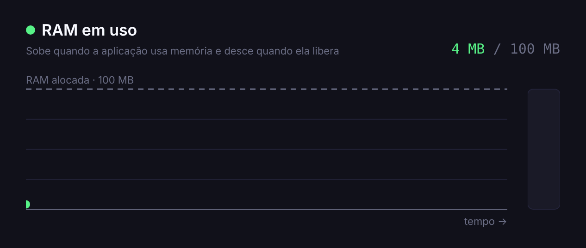

# Como funciona a RAM?

## ⚡ Resposta rápida


**A RAM não é um saldo que vai acabando.** Na Discloud, ela funciona igual à do seu computador: o uso sobe enquanto a aplicação está usando memória e desce quando ela libera.

Ver o uso de RAM subir **não** quer dizer que o seu plano está acabando. O plano gratuito não expira.


<figure><figcaption></figcaption></figure>

***

## 🧠 O que é a RAM

A RAM é a **memória de trabalho** da aplicação. É onde fica tudo o que ela está usando **neste momento**: variáveis, dados carregados, conexões abertas e cache.

Pense numa mesa de trabalho e num armário:

* A **RAM** é a **mesa**. Tudo o que você está usando agora fica em cima dela. É rápida, mas tem tamanho limitado e é esvaziada quando você para.
* O **disco** (SSD) é o **armário**. Guarda os arquivos de forma permanente, mesmo com tudo desligado.

No seu computador acontece o mesmo. Ao abrir um navegador com várias abas, o uso de RAM sobe. Ao fechar, ele desce. A memória não "gasta", ela só fica ocupada enquanto alguém está usando.

| Característica           | RAM                                    | Disco (SSD)                                       |
| ------------------------ | -------------------------------------- | ------------------------------------------------- |
| O que guarda             | O que a aplicação está usando agora    | Os arquivos da aplicação (código, dados, uploads) |
| Ao reiniciar a aplicação | É esvaziada e começa de novo           | Continua igual                                    |
| Velocidade               | Muito rápida                           | Mais lenta                                        |
| Na Discloud              | Limitada pela RAM alocada da aplicação | Aparece como `ssd` no status da aplicação         |

***

## 🔄 Por que o uso sobe e desce

O uso de RAM muda o tempo todo, conforme o que a aplicação está fazendo:

* **Ao iniciar**, ela carrega o código, as dependências e as conexões. O uso sobe rápido.
* **A cada ação**, como um comando, uma requisição ou uma imagem gerada, ela usa mais memória por um tempo.
* **Depois da ação**, essa memória é liberada e o uso desce.
* **Com o tempo**, bibliotecas como discord.js e discord.py guardam dados em cache (servidores, membros, mensagens) para responder mais rápido. Isso ocupa memória de forma contínua.


#### **A memória não volta na hora**

Node.js, Python e Java não devolvem a memória assim que a usam. Um **coletor de lixo** limpa de tempos em tempos. Por isso o uso pode ficar alto por um tempo e depois cair de uma vez. Isso é normal.


O que importa é a **tendência**. Se o uso sobe, oscila e depois fica numa faixa parecida, está tudo certo.

***

## 📏 RAM alocada e RAM em uso

São dois números diferentes:

| Número          | O que é                                                                               |
| --------------- | ------------------------------------------------------------------------------------- |
| **RAM alocada** | O máximo que a aplicação pode usar. Esse valor é reservado da RAM total do seu plano. |
| **RAM em uso**  | Quanto a aplicação está usando agora. Muda o tempo todo.                              |

No status da aplicação, os dois aparecem juntos. Por exemplo, `39.9MB/100MB` quer dizer que a aplicação está usando 39,9 MB de um limite de 100 MB.

Para ver o uso atual:

* No [Painel da Discloud](https://discloud.com/dashboard), na sua aplicação.
* No bot, com o comando `/status (ID)`. Veja os [Comandos do Bot](../../how-to-host-using/discord-bot/commands.md).
* Na [CLI](../../how-to-host-using/cli.md), com `discloud app status <ID>`.
* Na [API](../../api-and-integrations/api-overview/applications.md), no campo `memory` do status da aplicação.

***

## 🧮 De quanta RAM a aplicação precisa?

Depende da linguagem, das bibliotecas e de quanto a aplicação é usada. Algumas coisas costumam usar bastante memória:

* Tocar música, principalmente com `ffmpeg`.
* Gerar ou editar imagens.
* Abrir navegadores com [Puppeteer](../../configurations/puppeteer.md).
* Bots em muitos servidores, por causa do cache.
* Carregar arquivos grandes ou modelos de IA na memória.

Para escolher a RAM alocada:



**Veja o uso real**

Rode a aplicação por um tempo, usando as funções mais pesadas, e veja até onde o uso chega.



**Deixe uma folga**

Aloque um pouco acima do maior uso que você viu. Assim um pico não derruba a aplicação.



**Ajuste a RAM alocada**

Use a opção `RAM` no [`discloud.config`](../../configurations/discloud.config/), o comando `/memoria` do bot ou a [API](../../api-and-integrations/api-overview/applications.md). A RAM alocada conta para o total do seu plano.



***

## 🚫 O que acontece no limite

Se a aplicação tenta usar **mais RAM do que a alocada**, a Discloud **encerra** a aplicação. Isso não tem a ver com o plano acabar: a aplicação só passou do limite dela.

Para resolver, você pode:

* **Aumentar a RAM alocada**, se a aplicação realmente precisa de mais memória.
* **Reduzir o uso**, otimizando a parte do código que mais consome.

Veja também [Diagnosticando Aplicações Offline](../troubleshooting-solutions/diagnosing-offline-applications.md).

***

## 🚨 E se o uso nunca para de subir?

Se o uso **sobe sem parar**, nunca estabiliza e volta a subir do mesmo jeito depois de reiniciar, é provável que seja um **vazamento de memória** (_memory leak_). A aplicação guarda memória e nunca libera.


Aumentar a RAM **não corrige** um vazamento. A aplicação só demora mais para chegar no novo limite.


Causas comuns:

* Arrays, `Map` ou dicionários que só crescem e nunca têm itens removidos.
* `client.on(...)` ou `setInterval` criados **dentro** de um comando, que se repetem a cada uso.
* Cache da biblioteca sem limite. No discord.js, use `makeCache` e `sweepers`. No discord.py, ajuste `max_messages` e `member_cache_flags`.
* Navegadores ou processos abertos que nunca são fechados.


```javascript
// ❌ guarda todas as mensagens para sempre
const history = [];
client.on("messageCreate", (message) => history.push(message));

// ✅ guarda só as 100 últimas
const MAX_HISTORY = 100;
const recent = [];
client.on("messageCreate", (message) => {
  recent.push(message.content);
  if (recent.length > MAX_HISTORY) recent.shift();
});
```


Para encontrar a causa, escreva o uso de memória nos [logs](how-to-access-the-application-logs.md) de tempos em tempos e veja qual ação faz ele subir:



```javascript
setInterval(() => {
  const mb = process.memoryUsage().rss / 1024 / 1024;
  console.log(`RAM: ${mb.toFixed(1)} MB`);
}, 60_000);
```



```python
import tracemalloc

tracemalloc.start()

# depois de um tempo rodando:
for stat in tracemalloc.take_snapshot().statistics("lineno")[:10]:
    print(stat)  # as 10 linhas que mais alocam memória
```



***

## ❓ Ainda precisa de ajuda?

Veja as [**Perguntas Gerais**](./) ou junte-se ao nosso [**Servidor Discord**](https://discord.discloudbot.com/) para suporte.
