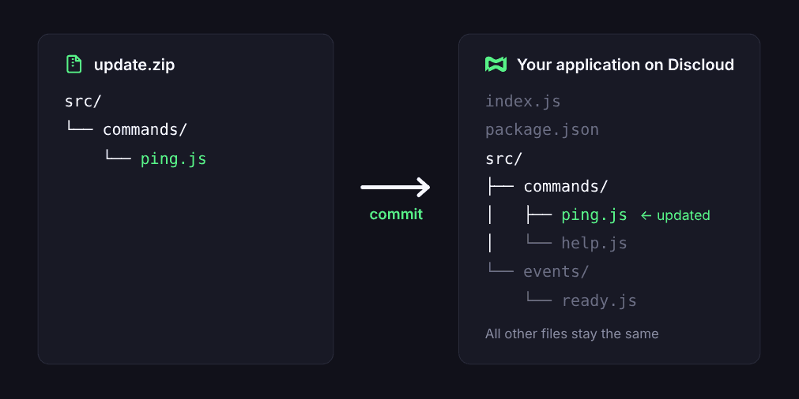

# Como fazer commit?

O **commit** atualiza os arquivos de uma aplicação que já está hospedada na Discloud. Em vez de enviar o projeto inteiro de novo, você envia só o que mudou.

***

## 🧩 Como o commit funciona

A Discloud usa o **caminho de cada arquivo dentro do `.zip`** para saber onde colocá-lo no projeto, contando a partir da [raiz do projeto](what-is-the-root-of-the-project.md):

* Se já existe um arquivo nesse caminho, ele é **substituído**.
* Se não existe, um arquivo **novo** é criado.
* Os arquivos que você não enviou **continuam como estão**.

<figure><figcaption><p>Só o <code>ping.js</code> é enviado; o resto do projeto não muda.</p></figcaption></figure>


**Maiúsculas e minúsculas fazem diferença.** A Discloud roda em Linux, onde `comandos` e `Comandos` são pastas diferentes. O mesmo vale para arquivos: `config.json` e `Config.json` não são o mesmo arquivo.


***

## 📦 Preparando o `.zip`



**Encontre o caminho do arquivo.**

Veja onde o arquivo está no seu projeto, a partir da raiz. Por exemplo: `src/comandos/ping.js`.



**Recrie as mesmas pastas.**

Coloque o arquivo dentro das mesmas pastas, com os mesmos nomes e a mesma extensão:

```
atualizacao.zip
└── src/
    └── comandos/
        └── ping.js
```



**Comprima o conteúdo, não a pasta do projeto.**

Selecione as pastas e arquivos que mudaram e comprima. Se você comprimir a pasta do projeto inteira (por exemplo, `meu-bot/`), ela entra no caminho e os arquivos vão para o lugar errado.



**Confira antes de enviar.**

Abra o `.zip`: a primeira coisa dentro dele deve ser `src/`, e não `meu-bot/`.




Use o [`.discloudignore`](../../configurations/.discloudignore.md) para deixar arquivos desnecessários de fora dos seus commits.


***

## ⚠️ Erros comuns

Imagine que o arquivo original está em `src/comandos/ping.js`:

<table><thead><tr><th width="260">Você enviou</th><th>O que acontece</th></tr></thead><tbody><tr><td>✅ <code>src/comandos/ping.js</code></td><td>O arquivo original é atualizado.</td></tr><tr><td>❌ <code>src/Comandos/ping.js</code></td><td>É criada uma pasta nova <code>Comandos/</code> ao lado de <code>comandos/</code>. O bot continua usando o arquivo antigo.</td></tr><tr><td>❌ <code>meu-bot/src/comandos/ping.js</code></td><td>A pasta <code>meu-bot/</code> é criada dentro do projeto, com uma cópia do arquivo. O original não muda.</td></tr><tr><td>❌ <code>ping.js</code></td><td>É criado um <code>ping.js</code> na raiz do projeto. O <code>src/comandos/ping.js</code> não muda.</td></tr></tbody></table>


Se o commit não teve efeito, procure no projeto uma pasta duplicada como as da tabela. Normalmente o arquivo foi para o caminho errado.


***

## 🚀 Enviando o commit





Vá ao canal [**`#🔌・commands`**](https://discord.com/channels/584490943034425391/1051126795883261962) no **Servidor Discord da Discloud**.



Execute o comando:

```
/commit
```



Envie o seu `.zip` quando o bot solicitar.





Na raiz do projeto, execute:

```bash
discloud app commit <ID_DA_APLICACAO>
```

A [CLI](../../how-to-host-using/cli.md) monta o `.zip` por você a partir da pasta atual, por isso execute o comando na raiz do projeto. Também funciona a forma curta `discloud app c`.





No explorador de arquivos do VS Code, selecione os arquivos e pastas que mudaram.



Clique com o botão direito e escolha **Discloud > Commit**.



Escolha a aplicação que vai receber o commit.



Veja como instalar e entrar na [extensão do VS Code](../../how-to-host-using/visual-studio-code.md).



Com a [Integração com GitHub](../../api-and-integrations/github-integration.md), a aplicação é atualizada a partir do seu repositório, sem precisar montar `.zip`.



***

## ✅ Antes de enviar, confira

* O caminho é o mesmo do projeto, a partir da raiz.
* Os nomes de pastas e arquivos são iguais, com as mesmas maiúsculas e minúsculas.
* A extensão está certa (`ping.js`, não `ping.js.txt`).
* O `.zip` começa direto nas pastas do projeto, sem a pasta do projeto por fora.

***

## ❓ Ainda precisa de ajuda?

Veja [**Soluções de Problemas**](../troubleshooting-solutions/) ou junte-se ao nosso [**Servidor Discord**](https://discord.discloudbot.com/) para suporte.
