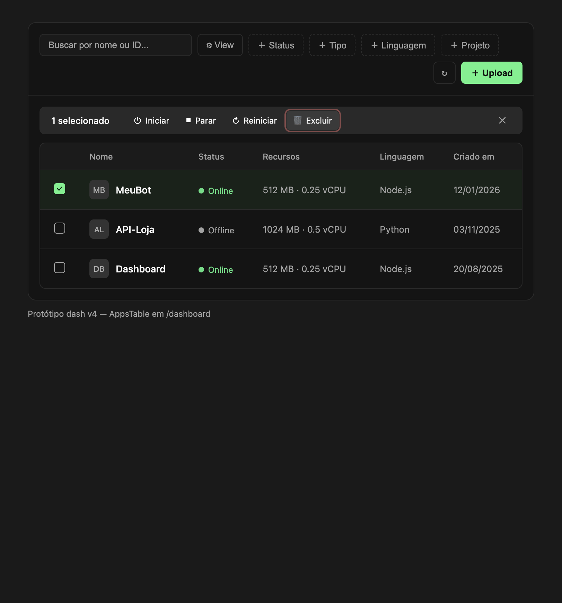
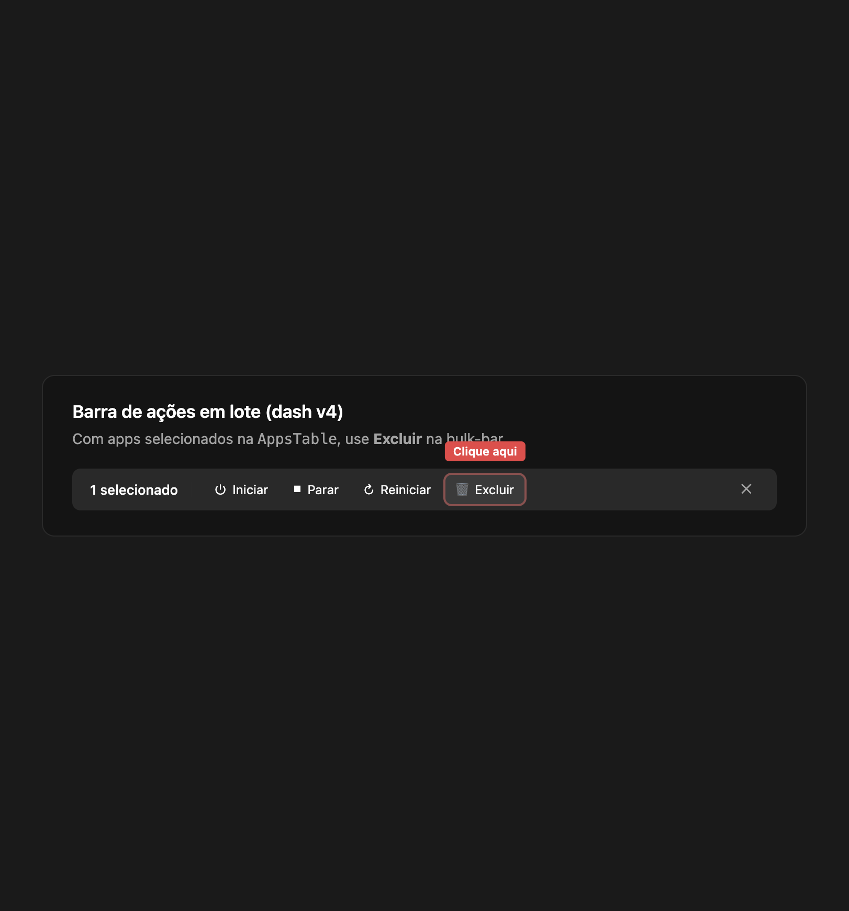
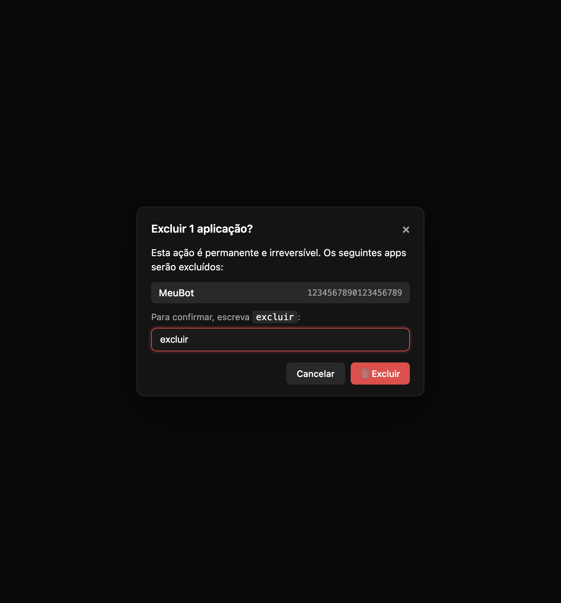

# How to delete an application?

## 🗑️ Overview

In the [Dashboard](https://discloud.com/dashboard) (dash v4), deletion is from the **applications list** (`AppsTable`): select the app(s) and use the **bulk bar** → **Delete**.

You can delete **one or several** apps at once.


Deletion is **permanent and irreversible**. To confirm, the dashboard requires typing **`delete`** (in the Portuguese UI: **`excluir`**).

In some cases [Snapshots](../../platform-features/snapshots.md) may still exist on the account — that is not a full file backup.


***

## 🚀 Step by step (dash v4)



**Open the apps list**

Open the [Dashboard](https://discloud.com/dashboard). The main list is the `AppsTable` (search, View, Status/Type/Language/Project filters, Upload).



**Select the application**

Check the **checkbox** on the left of the app. The bulk bar appears with “1 selected” and Start / Stop / Restart / **Delete**.

<figure><figcaption></figcaption></figure>



**Click Delete**

On the bulk bar, click **Delete** (trash icon).

<figure><figcaption></figcaption></figure>



**Confirm by typing delete**

The modal lists the app name(s) and ID(s). Type **`delete`** (PT UI: **`excluir`**) and click **Delete** — or **Cancel**.

<figure><figcaption></figcaption></figure>



***

## ✅ What happens next

* The dashboard deletes each selected app.
* On success, the app disappears from the list (you stay on `/dashboard`).
* If one fails, you get a toast; others may still have been deleted.

***

## ⚠️ Before you delete

| Situation          | What to do                                                                   |
| ------------------ | ---------------------------------------------------------------------------- |
| You need the files | Take a [backup](../../platform-features/backups.md) or download what matters |
| Domain / subdomain | They are released afterward; the subdomain may show as **Free** again        |
| Team app           | Only someone with permission can delete                                      |
| Want history later | See [Snapshots](../../platform-features/snapshots.md)                        |


Screenshots follow **dash v4** (`/dashboard`, `AppsTable`). You can also delete from the app overview (`/dashboard/app/{id}`) by typing the app **name** in the modal. Mockup labels are in Portuguese (PT UI copy).

