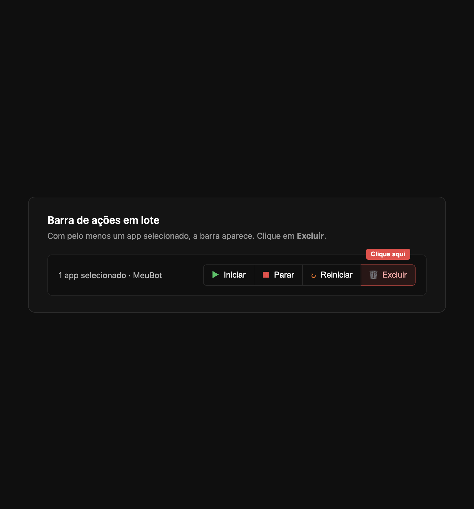

# How to delete an application?

## 🗑️ Overview

In the dashboard, delete is **not** inside the app page. You delete from the **applications list**: select the app(s) and use the bulk action bar (**Delete**).

You can delete **one or several** apps at once.


Deletion is **permanent**. Application data is lost. In some cases [Snapshots](../../platform-features/snapshots.md) may still exist on the account — that is not a full backup.


***

## 🚀 Step by step



**Open the apps list**

In the [Discloud Dashboard](https://discloud.com/dashboard), go to your account **applications** list.



**Select the application**

In the table, check the **checkbox** on the left of the app you want to delete. The dashboard shows something like “1 app selected” and enables the action bar.

<figure><figcaption></figcaption></figure>



**Click Delete**

On the action bar (Start / Stop / Restart / **Delete**), click **Delete** (trash icon).

<figure><figcaption></figcaption></figure>



**Confirm in the modal**

A confirmation modal opens. It lists the app name(s) and ID(s). Read the warning and click **Yes, delete** — or **Cancel** if you changed your mind.

<figure><figcaption></figcaption></figure>



***

## ✅ What happens next

* The dashboard deletes each selected app.
* On success, the app disappears from the list.
* If one fails, you get a toast; others may still have been deleted.

***

## ⚠️ Before you delete

| Situation          | What to do                                                                   |
| ------------------ | ---------------------------------------------------------------------------- |
| You need the files | Take a [backup](../../platform-features/backups.md) or download what matters |
| Domain / subdomain | They are released afterward; the subdomain may show as **Free** again        |
| Team app           | Only someone with permission can delete                                      |
| Want history later | See [Snapshots](../../platform-features/snapshots.md)                        |


The screenshots on this page are **prototypes** of the dashboard flow (sitev3). The live UI may differ slightly (language, theme, labels). Portuguese labels in the images match the PT dashboard copy.

