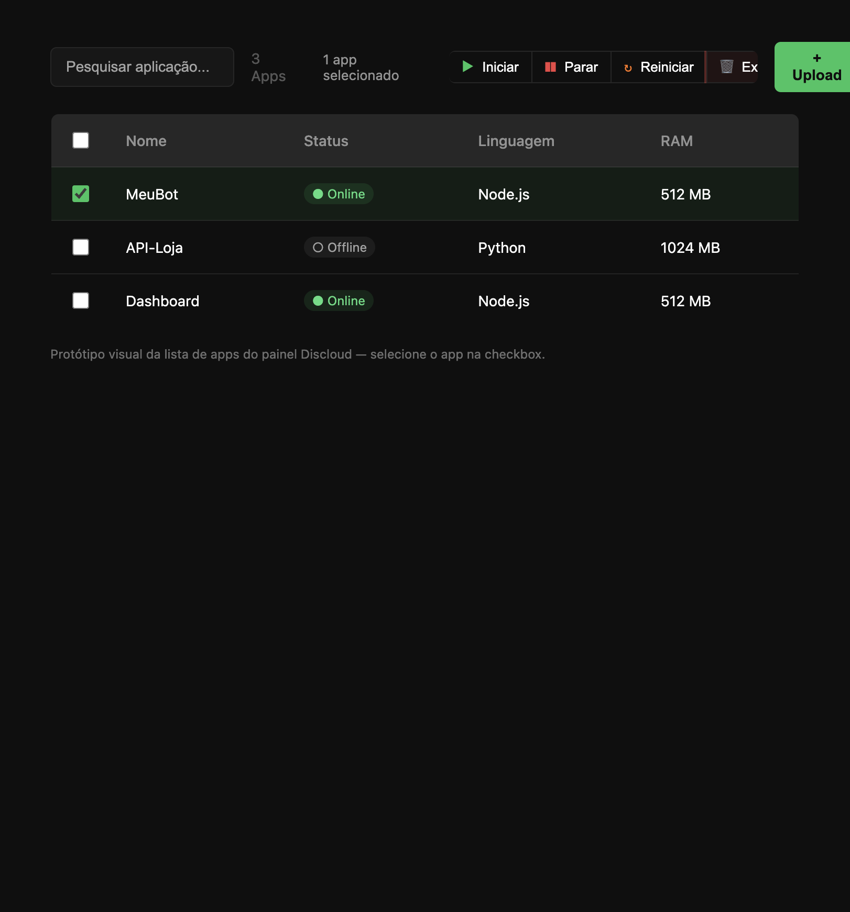
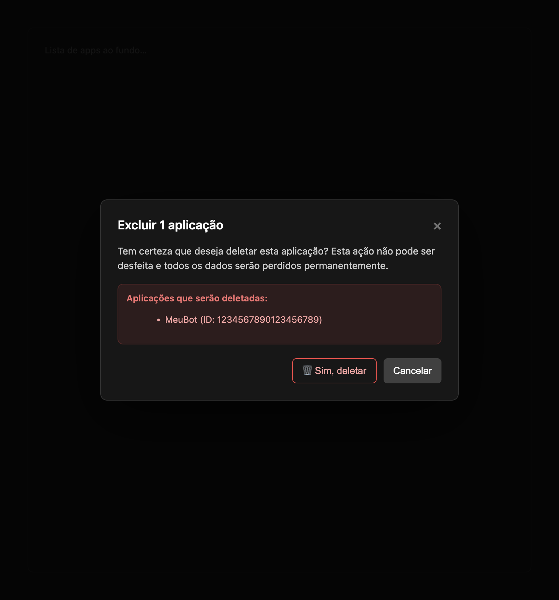

# Como excluir uma aplicação?

## 🗑️ Visão geral

No painel, a exclusão **não** fica dentro da página do app. Você exclui pela **lista de aplicações**: marca o(s) app(s) e usa a barra de ações em lote (**Excluir**).

Dá para excluir **um ou vários** apps de uma vez.


A exclusão é **permanente**. Os dados da aplicação são perdidos. Em alguns casos ainda pode haver [Snapshots](../../platform-features/snapshots.md) na conta — não confunda com backup completo.


***

## 🚀 Passo a passo



**Abrir a lista de apps**

No [Painel da Discloud](https://discloud.com/dashboard), vá até a área de **aplicações** (lista de apps da conta).



**Selecionar a aplicação**

Na tabela, marque a **checkbox** à esquerda do app que quer excluir. O painel mostra algo como “1 app selecionado” e libera a barra de ações.

<figure><figcaption></figcaption></figure>



**Clicar em Excluir**

Na barra de ações (Iniciar / Parar / Reiniciar / **Excluir**), clique em **Excluir** (ícone de lixeira).

<figure><figcaption></figcaption></figure>



**Confirmar no modal**

Abre um modal pedindo confirmação. Ele lista o nome e o ID do(s) app(s). Leia o aviso e clique em **Sim, deletar** — ou **Cancelar** se mudou de ideia.

<figure><figcaption></figcaption></figure>



***

## ✅ O que acontece depois

* O painel chama a exclusão de cada app selecionado.
* Se der certo, o app some da lista.
* Se algum falhar, aparece um aviso; os outros podem ter sido excluídos mesmo assim.

***

## ⚠️ Antes de excluir

| Situação              | O que fazer                                                              |
| --------------------- | ------------------------------------------------------------------------ |
| Precisa dos arquivos  | Faça [backup](../../platform-features/backups.md) ou baixe o que importa |
| Domínio / subdomínio  | Liberam depois; o subdomínio pode ficar **Livre** de novo                |
| App em equipe         | Só quem tem permissão consegue excluir                                   |
| Quer histórico depois | Veja [Snapshots](../../platform-features/snapshots.md)                   |


As imagens desta página são **protótipos** fiéis ao fluxo do painel (sitev3). A UI real pode ter pequenos detalhes diferentes (idioma, tema, labels).

