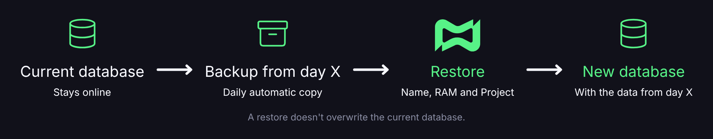

# Backups

## 💾 O que é um backup?

Um backup na Discloud é uma cópia baixável dos dados de uma aplicação ou de um banco de dados. Há dois tipos:

| Tipo           | Como é gerado                                   | Onde aparece                                      | Por quanto tempo       |
| -------------- | ----------------------------------------------- | ------------------------------------------------- | ---------------------- |
| **Manual**     | Você clica em **Backup** na visão geral da app. | Na janela de download, na hora.                   | Você guarda o arquivo. |
| **Automático** | A Discloud gera **uma cópia por dia**.          | App → **Backups** ou Banco de dados → **Backups** | Cerca de **7 dias**.   |

* O backup **manual** da aplicação está disponível em todos os planos.
* O backup **automático** exige o plano [**Diamond ou superior**](https://discloud.com/plans).


Backups são diferentes de **Snapshots**, que guardam versões das suas apps na conta, inclusive depois que uma app é excluída. Veja a página **Snapshots**.


***

## 🖐️ Backup manual de uma aplicação



**Abrir a aplicação**

No [Painel da Discloud](https://discloud.com/dashboard), abra a visão geral da aplicação.



**Gerar o backup**

Clique em **Backup** e aguarde. O progresso aparece no widget de operações (**Builds**).



**Baixar o arquivo**

Quando o link estiver pronto, o painel abre a janela **Download do backup**:

* **Baixar** salva o arquivo direto no navegador.
* **Copiar link** copia a URL temporária. Use se o navegador bloquear o download e abra o link em outra aba.



O arquivo costuma ser `.zip` para aplicações e `.sql` para bancos de dados. Use o nome de arquivo sugerido na janela de download. O ID do backup não é o nome do arquivo.


O link de download é temporário. Se precisar do backup por mais tempo, guarde o arquivo fora da Discloud.


***

## 📅 Backups automáticos

### Aplicações

Painel → aplicação → **Backups**.

* A página lista as cópias diárias dos últimos \~7 dias.
* Cada cópia pode ser baixada pelo dono ou por um membro da equipe com a permissão `backup_app`.
* Em planos abaixo do Diamond, a página mostra como fazer upgrade.

### Bancos de dados

Painel → banco de dados → **Backups**.

Além de listar e baixar, um [banco de dados](../../api-and-integrations/databases.md) pode ser **restaurado** a partir de um backup automático.



**Escolher o backup**

Escolha o backup automático do dia que você quer recuperar.



**Abrir o restore**

Abra a ação de restore do backup.



**Confirmar os dados**

Confirme o nome, a RAM e, se quiser, o Projeto do banco novo. Acompanhe o progresso no widget de operações.



<figure><figcaption></figcaption></figure>


O restore **cria um banco novo** com os dados daquele backup. O banco atual **não é sobrescrito** e continua no ar.


***

## 👥 Permissões em equipe

* Em um app compartilhado, baixar backup exige a permissão `backup_app`. Sem ela, a lista pode aparecer, mas o download falha com um aviso de permissão.
* O plano que libera o backup automático é o do **dono** do recurso, não o do membro.

***

## 🧭 Quando usar cada um

| Situação                                           | Use                                                          |
| -------------------------------------------------- | ------------------------------------------------------------ |
| Vai fazer uma mudança arriscada agora              | Backup **manual** antes da mudança                           |
| Quer o histórico diário dos últimos dias           | Backup **automático** (Diamond ou superior)                  |
| Excluiu a app e precisa do que sobrou              | **Snapshots**                                                |
| Precisa de uma cópia do banco a partir de um dia X | **Restore** em Banco de dados → Backups (cria um banco novo) |

***

## ⚠️ Limitações

* O backup automático **não** substitui a sua própria política de retenção fora da Discloud.
* Depois de \~7 dias, a cópia automática sai da lista.
* Não use o backup como único meio de migrar entre contas sem testar o restore antes.
* Se o link expirou ou foi removido, gere outro backup ou escolha uma cópia mais recente.
