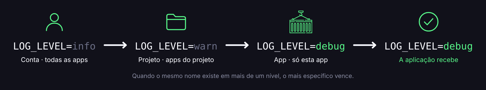
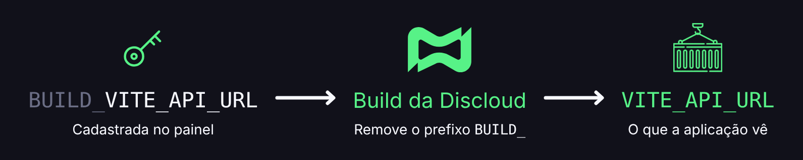

# Variáveis de Ambiente

## 🔑 O que são?

Variáveis de ambiente são pares `NOME=valor` que a aplicação lê enquanto roda. Se você usar o prefixo `BUILD_`, elas também ficam disponíveis no build.

No painel da Discloud elas existem em **três níveis**. Quanto mais específico o nível, mais ele manda.

<figure><figcaption></figcaption></figure>

Se o mesmo nome existir nos três níveis, a aplicação recebe o valor da **app**. Se não houver na app, usa o do **projeto**. Se não houver no projeto, usa o da **conta**.

***

## 📍 Onde fica cada nível

| Nível       | Caminho no painel              | Vale para                |
| ----------- | ------------------------------ | ------------------------ |
| **Conta**   | Painel → **Variáveis globais** | Todas as suas aplicações |
| **Projeto** | Projeto → **Variáveis**        | As apps daquele Projeto  |
| **App**     | Aplicação → **Variáveis**      | Só aquela aplicação      |


Não coloque segredos no Git. O arquivo [`.env`](../../faq/general-questions/.env-file.md) do repositório não substitui o painel. Em produção, use as variáveis da Discloud.


***

## 👤 Quem pode editar

| Nível       | Quem edita                                                                                                 |
| ----------- | ---------------------------------------------------------------------------------------------------------- |
| **Conta**   | O dono da conta.                                                                                           |
| **Projeto** | O dono do Projeto, ou um membro da equipe com papel **Admin** ou **Developer**. O Viewer não vê nem edita. |
| **App**     | O dono do app, ou um membro da equipe com permissão de configurar o app.                                   |

***

## ✏️ Como editar

Os três níveis têm o mesmo editor:

| Ação                   | O que faz                                                                                                                |
| ---------------------- | ------------------------------------------------------------------------------------------------------------------------ |
| **Adicionar**          | Cria uma variável com nome e valor.                                                                                      |
| **Mostrar / ocultar**  | Mostra ou esconde o valor na tela.                                                                                       |
| **Copiar**             | Copia um valor ou todas as variáveis.                                                                                    |
| **Colar .env**         | Importa linhas `NOME=valor`. Aceita comentários `#`, `export` e aspas. Dá para mesclar com as atuais ou substituir tudo. |
| **Remover**            | Remove uma variável ou limpa o nível inteiro.                                                                            |
| **Salvar / Descartar** | Grava ou desfaz as alterações pendentes.                                                                                 |

Há um limite de variáveis por nível. Se uma importação passar do limite, o painel avisa antes de aplicar.


Depois de colar um `.env`, revise a lista e clique em **Salvar**. A importação sozinha não grava nada.


***

## 🔄 Aplicar as mudanças

Salvar no painel **grava** as variáveis, mas a aplicação em execução continua com os valores antigos até um **rebuild** ou um novo **deploy**.



**Salvar no nível certo**

Edite e salve na app, no projeto ou na conta.



**Fazer rebuild ou deploy**

Na app, clique em **Rebuild** ou faça um novo [commit](../../faq/general-questions/how-to-commit.md).



**Conferir os logs**

Veja nos [logs](../../faq/general-questions/how-to-access-the-application-logs.md) se a app subiu com o comportamento esperado.




Variáveis da conta ou do projeto afetam **todas** as apps daquele nível. Depois de mudar, faça rebuild ou deploy em cada app que precisa do valor novo.


***

## 🏗️ Prefixo `BUILD_`

Por padrão, as variáveis só ficam disponíveis com a app já rodando.

Frameworks como Vite, Next.js, Nuxt, Astro, React, Vue, Svelte e Angular muitas vezes precisam de valores **durante o build**. Nesses casos, cadastre a variável com o prefixo `BUILD_`.

| No painel                | No build e na app rodando |
| ------------------------ | ------------------------- |
| `BUILD_VITE_API_URL`     | `VITE_API_URL`            |
| `BUILD_NEXT_PUBLIC_SITE` | `NEXT_PUBLIC_SITE`        |

<figure><figcaption></figcaption></figure>

O prefixo `BUILD_` é só um marcador da Discloud. Ele é **removido automaticamente** no build, e a aplicação **nunca** vê o nome com `BUILD_`.

Use `BUILD_` só quando o valor precisa existir no build. Segredos que a API usa apenas com a app rodando podem ficar sem o prefixo.

***

## 💡 Boas práticas

* Use nomes em `MAIUSCULAS_COM_UNDERLINE`.
* Coloque na **conta** só o que é realmente global, como um token usado por todos os bots.
* Coloque no **projeto** o que o grupo de apps compartilha, como a URL do banco interno ou a chave de API do produto.
* Coloque na **app** o que é específico, como o webhook daquele bot ou uma flag de feature.
* Evite repetir o mesmo nome em níveis diferentes sem querer. O valor da app esconde o do projeto sem nenhum aviso.
* Não guarde segredos no [`discloud.config`](../../configurations/discloud.config/). Use o painel.

Para automatizar, veja a [API de Variáveis de ambiente](../../api-and-integrations/api-overview/environment-variable.md).
