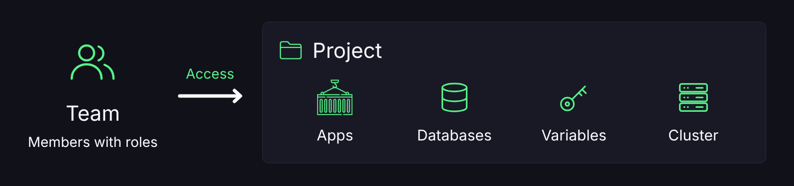

# Projetos

## 📂 O que é um Projeto?

Um Projeto agrupa aplicações e bancos de dados que trabalham juntos. Serve para organizar a conta, centralizar variáveis compartilhadas e, se quiser, dar acesso a uma equipe.

Projeto **não** é um plano novo e **não** cria um servidor. As apps e os bancos continuam sendo os recursos reais. O Projeto só define o agrupamento e quem tem acesso.

***

## 📋 Requisitos

* Criar Projetos exige o plano [**Diamond ou superior**](https://discloud.com/plans).
* Quem é membro de uma equipe com um Projeto vinculado também vê esse Projeto na lista, mesmo sem ser o dono. O que cada pessoa pode fazer depende do papel dela na equipe.

***

## 📍 Onde fica

[Painel da Discloud](https://discloud.com/dashboard) → **Projetos**.

Dentro de um Projeto você encontra:

| Área               | Para que serve                                         |
| ------------------ | ------------------------------------------------------ |
| **Visão geral**    | Lista de apps e bancos do Projeto, atalhos e metadados |
| **Access manager** | Vincular ou desvincular uma equipe                     |
| **Variáveis**      | Variáveis compartilhadas por todas as apps do Projeto  |
| **Configurações**  | Nome, descrição e exclusão                             |

***

## 🧩 O que um Projeto contém

| Item                      | Detalhe                                                |
| ------------------------- | ------------------------------------------------------ |
| **Aplicações**            | As apps vinculadas ao Projeto.                         |
| **Bancos de dados**       | Os bancos vinculados ao Projeto.                       |
| **Cluster**               | Todas as apps do Projeto precisam ficar nesse cluster. |
| **Variáveis de ambiente** | Valores compartilhados pelas apps do Projeto.          |
| **Equipe**                | Opcional. No máximo uma por Projeto.                   |

<figure><figcaption></figcaption></figure>

Sem equipe vinculada, só o dono gerencia o Projeto e o que está dentro dele.

***

## 🚀 Criar um Projeto



**Abrir Projetos**

No painel, abra **Projetos** e clique em **Novo projeto**.



**Preencher os dados**

Informe o **nome** (obrigatório, de 3 a 50 caracteres). A descrição e o ícone são opcionais.



**Confirmar**

O cluster é atribuído automaticamente. Você pode vincular uma equipe depois, no **Access manager**.



***

## 🔗 Vincular aplicações

No Projeto, use **Adicionar app** (ou **Vincular app**).

* Apps que já estão em outro Projeto **não** aparecem na lista. Tire-as do Projeto atual antes.
* Se a app está em um **cluster diferente** do Projeto, a Discloud inicia uma **migração**. Ela pode levar alguns minutos e a app fica offline enquanto migra. Acompanhe em **Builds**.
* **Sair do projeto** só desvincula a app. Ela **não** é excluída.
* No upload de uma app nova (ZIP ou GitHub), dá para escolher o Projeto na hora, se você tiver permissão de upload nele.


Apps hospedadas com **Dockerfile** não migram de cluster automaticamente. Para colocá-las no Projeto, remova a app e hospede de novo, já escolhendo o Projeto no upload.


***

## 🗄️ Vincular bancos de dados

Um [banco de dados](../../api-and-integrations/databases.md) criado com um Projeto selecionado já nasce vinculado a ele. Na visão do Projeto, a seção **Banco de dados** lista só os bancos desse grupo.

Criar um banco de dados também exige o plano **Diamond ou superior**, o mesmo de Projetos e equipes.

***

## 👥 Access manager (equipe)

Painel → Projeto → **Access manager**.

* **Vincular:** escolha uma equipe da qual você é dono. Os membros passam a ver o Projeto e as apps e bancos dele, conforme o papel de cada um.
* **Desvincular:** a equipe perde o acesso na hora. O Projeto continua seu e as apps não são apagadas.


Um Projeto fica vinculado a no máximo uma equipe por vez.


***

## ⚙️ Configurações e exclusão

| Ação                    | Quem pode                           | Efeito                                                                     |
| ----------------------- | ----------------------------------- | -------------------------------------------------------------------------- |
| Editar nome e descrição | Dono, ou membro **admin** da equipe | Muda só os metadados.                                                      |
| Excluir o Projeto       | Dono                                | Remove o Projeto. Apps e bancos **continuam** na conta, sem o agrupamento. |
| Transferir o Projeto    | Ninguém                             | Ainda não está disponível no painel.                                       |

***

## 🔀 Projeto, equipe e app

| Conceito        | Papel                                                           |
| --------------- | --------------------------------------------------------------- |
| **App / Banco** | O recurso que roda e consome RAM.                               |
| **Projeto**     | Agrupa recursos, define o cluster e as variáveis comuns.        |
| **Equipe**      | Pessoas com papéis. Ganha acesso quando vinculada a um Projeto. |

O fluxo típico é criar o Projeto, vincular (ou criar) as apps e os bancos nele e, se a equipe for trabalhar junto, criar uma equipe, adicionar os membros e vinculá-la ao Projeto.

Para automatizar, veja a [API de Projeto](../../api-and-integrations/api-overview/project.md).
