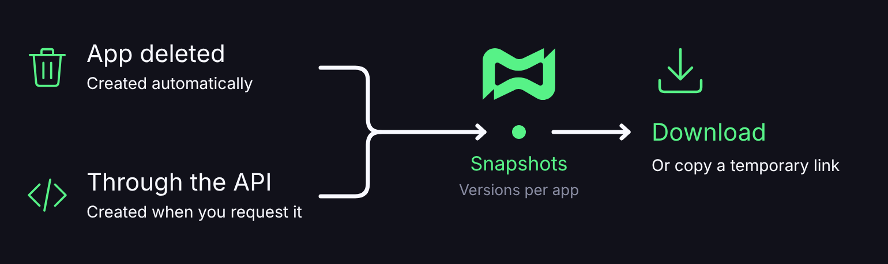

# Snapshots

## 🕒 What are Snapshots?

Snapshots are **versioned backups** of your applications, gathered in a single place in your account. They let you download an older version of an app's code and files, even after the app has been deleted.


Snapshots are different from each app's **Backups** page, which keeps the daily automatic copies and creates manual backups on demand.


***

## 📋 Requirements

* Listing and downloading snapshots is available on **every plan**.
* There is no "create snapshot" button in the dashboard. Versions are created in other ways (see below).

***

## 📍 Where to find it

[Discloud Dashboard](https://discloud.com/dashboard) → **Snapshots** (in the Tools group).

Each app in the list shows how many **versions** it has, the total size and the date of the latest backup. The list is split into pages. Use the search by ID to find an app quickly.

***

## 🧬 Where snapshots come from

Snapshots are created in two ways:

* **Through the API**, with the [Snapshot API](../../api-and-integrations/api-overview/snapshot.md).
* **Automatically, when an application is deleted.**

<figure><figcaption></figcaption></figure>

This means deleting an app doesn't immediately lose its latest version. That version shows up in Snapshots for download while it's within Discloud's retention period.

***

## ⬇️ Download a version



**Open Snapshots**

In the dashboard, open **Snapshots**.



**Find the app**

Find the app in the list. If needed, search by ID.



**See the versions**

Click **See versions**. The versions are also split into pages.



**Download**

On the version you want, click **Download** or **Copy link**. The link is temporary. If the browser blocks the download, use **Copy link** and open it in another tab.




Some versions show a deadline, like "Expires in X days". After that, they leave the list.


***

## 🔀 Snapshots, Backups and Deploy

| Feature              | What it's for                                                                             |
| -------------------- | ----------------------------------------------------------------------------------------- |
| **Snapshots**        | Version history of each app in your account. Useful after deleting an app.                |
| **Manual backup**    | A copy right now, from the app overview.                                                  |
| **Automatic backup** | A daily copy for \~7 days (Diamond or higher), on the app's or database's Backups page.   |
| **GitHub / Commit**  | Source code in the repository. It doesn't replace the snapshot of the hosted app's files. |

A snapshot does **not** restore the app in one click. You download the file and host it again, or reuse the content in whatever way makes sense for your project.

***

## 💡 Best practices

* Before deleting an important app, also make a **manual backup** and keep it outside Discloud.
* After deleting, check **Snapshots** soon. Don't wait for the retention period to end.
* In a Team, whoever downloads needs the right permission on the resource. The account owner sees the snapshots of their own apps on this screen.
* Don't rely only on snapshots for compliance or long-term retention. Download and archive anything you're required to keep.
