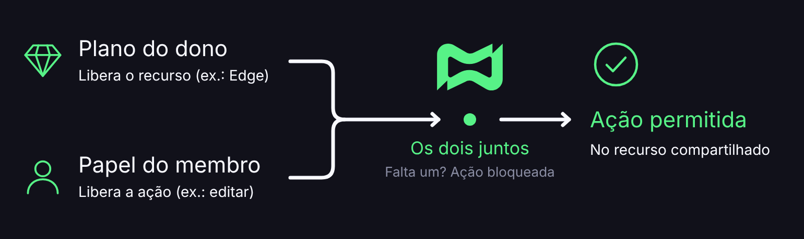

# Equipes e Permissões

## 👥 O que é uma equipe?

Uma equipe é um grupo de pessoas que compartilham Projetos e, com eles, as apps e os bancos de dados desses Projetos. Cada membro tem um **papel**, que define o que a pessoa pode ver e alterar no painel.

Há duas coisas diferentes que decidem o que um membro consegue fazer:

| O quê               | O que controla                                                                | Quem define                                       |
| ------------------- | ----------------------------------------------------------------------------- | ------------------------------------------------- |
| **Plano**           | Quais recursos a conta do **dono** liberou (Console, domínio, Edge e outros). | A assinatura do dono do recurso.                  |
| **Papel na equipe** | O que **você** pode fazer nesse recurso compartilhado.                        | O dono da equipe, ao convidar ou editar o membro. |

<figure><figcaption></figcaption></figure>

Em um app compartilhado, o plano que vale para os recursos avançados é o do **dono do app**, não o seu. O seu papel só decide se você pode usar aquela tela.

***

## 📋 Requisitos

* Criar uma equipe exige o plano [**Diamond ou superior**](https://discloud.com/plans).
* Você pode ser **membro** de uma equipe mesmo com um plano menor. O dono convida pelo [ID da sua conta Discloud](../../faq/general-questions/how-can-i-get-my-discloud-account-id.md).

***

## 📍 Onde fica

[Painel da Discloud](https://discloud.com/dashboard) → **Team** (em Configurações).

Na página da equipe você encontra:

* a lista de **membros**, com papel, data de entrada e opção de remover
* a lista de **Projetos** vinculados
* as opções de editar nome e descrição, sair da equipe ou, se for o dono, excluir a equipe

Também dá para vincular ou desvincular uma equipe pelo **Access manager** do Projeto.

***

## 🎭 Papéis

| Papel         | Resumo                                                                                                                   |
| ------------- | ------------------------------------------------------------------------------------------------------------------------ |
| **Owner**     | Dono da equipe. Gerencia tudo: membros, Projetos e exclusão da equipe.                                                   |
| **Admin**     | Gerencia a equipe e os Projetos (nome, acesso e membros). Opera apps e variáveis.                                        |
| **Developer** | Opera Projetos e apps (upload, variáveis do Projeto e configuração do app, se tiver a permissão). Não gerencia a equipe. |
| **Viewer**    | Somente leitura. Não vê nem edita as variáveis do Projeto, não faz upload e não altera configurações.                    |

### No Projeto

| Ação                               | Dono do Projeto | Admin | Developer | Viewer |
| ---------------------------------- | --------------- | ----- | --------- | ------ |
| Ver o Projeto                      | Sim             | Sim   | Sim       | Sim    |
| Ver e editar variáveis do Projeto  | Sim             | Sim   | Sim       | Não    |
| Upload ou vincular app ao Projeto  | Sim             | Sim   | Sim       | Não    |
| Editar nome e descrição do Projeto | Sim             | Sim   | Não       | Não    |
| Excluir o Projeto                  | Sim             | Não   | Não       | Não    |
| Vincular ou desvincular a equipe   | Sim             | Não   | Não       | Não    |


O dono do Projeto é a conta que criou o Projeto. Pode ser a mesma pessoa que é dona da equipe, mas são papéis diferentes.


### Nas aplicações e bancos compartilhados

Em apps e bancos compartilhados por uma equipe, cada ação depende de uma permissão do membro. O painel mostra ou esconde as ações conforme essas permissões.

| Área                                                             | Permissão      |
| ---------------------------------------------------------------- | -------------- |
| Configurações do app (auto-restart, rede privada, domínio, Edge) | `config_app`   |
| Explorer (arquivos)                                              | `explorer_app` |
| Console web                                                      | `terminal_app` |
| Baixar backup                                                    | `backup_app`   |
| Alterar configuração ou fazer rebuild de um banco de dados       | `commit_app`   |
| Alterar a RAM de um banco de dados                               | `edit_ram`     |

Se uma ação aparecer bloqueada, há dois motivos possíveis. O seu papel não inclui aquela permissão, ou o plano do **dono** não libera o recurso (por exemplo, o Edge exige Ruby ou superior).

***

## 🚀 Criar e gerenciar uma equipe



**Criar a equipe**

Em **Team**, clique em **Novo team**. Informe o nome (de 3 a 50 caracteres) e, se quiser, uma descrição.



**Adicionar membros**

Abra a equipe e clique em **Adicionar membro**. Informe o [**ID da conta Discloud**](../../faq/general-questions/how-can-i-get-my-discloud-account-id.md) da pessoa (não o username do Discord) e escolha o papel.



**Vincular um Projeto**

Em **Adicionar projeto**, escolha um Projeto do qual você é dono e que ainda não está em outra equipe.




Cada Projeto fica em **uma** equipe por vez.


### Remover acesso

| Ação                    | Efeito                                                                       |
| ----------------------- | ---------------------------------------------------------------------------- |
| **Remover membro**      | A pessoa perde na hora o acesso aos Projetos, apps e bancos daquela equipe.  |
| **Desvincular Projeto** | O Projeto continua existindo. Só deixa de ser compartilhado com a equipe.    |
| **Sair da equipe**      | Você mesmo remove o seu acesso.                                              |
| **Excluir equipe**      | Ação permanente do dono. Os Projetos ficam sem equipe, mas não são apagados. |


Ao remover alguém ou desvincular um Projeto, o acesso cai na hora. Avise a equipe antes.


***

## 💎 Plano do dono e plano do membro

Um caso comum é o dono ter Diamond ou Ruby e convidar um membro que está no Free ou no Gold.

* O membro **vê** o app compartilhado.
* Recursos como Console, Explorer, domínio e Edge seguem o plano do **dono**, desde que o papel do membro permita a ação.
* Criar um Projeto **novo**, uma equipe **nova** ou comprar um add-on continua exigindo o plano da **sua** conta.

Para automatizar, veja a API de [Equipe](../../api-and-integrations/api-overview/team.md) e de [Aplicações da Equipe](../../api-and-integrations/api-overview/team-apps.md).
