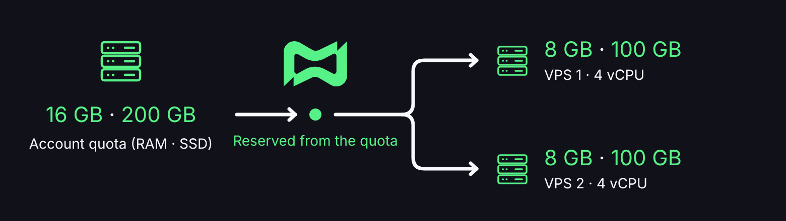

# VPS

## 🖥️ O que é uma VPS na Discloud?

A VPS é um computador na nuvem só seu, com acesso **root** por SSH. Você instala e roda o que precisar nele. Ela **não** usa a RAM nem o disco do plano de bots e sites: a cota é um add-on à parte.

Há dois passos, nesta ordem:

1. **Comprar cota** de RAM e SSD.
2. **Criar uma ou mais máquinas** que consomem essa cota.


Comprar recursos não liga uma máquina sozinha. Criar a máquina também não cobra um plano novo: ela só reserva gigabytes que você já tem.


***

## 📍 Onde fica

No [Painel da Discloud](https://discloud.com/dashboard), abra a seção **VPS**.

* **Comprar recursos** abre a compra de RAM + SSD.
* **Nova VPS** cria a máquina, se já houver cota livre suficiente.
* Cada máquina tem visão geral (acesso, IP, reiniciar, recriar) e **Configurações** (nome, hardware, sistema, excluir).

A mesma cota também aparece em **Assinatura → Add-ons**.

***

## 💾 1. Cota de RAM e SSD

RAM e SSD são contratados **juntos**. Na primeira compra, os dois entram no mesmo checkout. Você escolhe quantos gigabytes de cada um e vê o total mensal antes de pagar.

| Recurso  | Mínimo | Degrau         |
| -------- | ------ | -------------- |
| RAM      | 8 GB   | de 2 em 2 GB   |
| SSD NVMe | 100 GB | de 50 em 50 GB |

A cota é um **pool da conta**, não "uma máquina pronta". Exemplo: 16 GB de RAM e 200 GB de SSD podem virar uma máquina de 16/200, ou duas de 8/100, desde que a soma caiba no que foi comprado.

<figure><figcaption></figcaption></figure>

O que já está em máquinas aparece como **em uso**. O resto é **livre** e pode ir para uma máquina nova ou para aumentar uma existente.

Dá para **aumentar** a cota quando quiser. Dá para **reduzir** só até o que as máquinas já estão usando. Se 10 GB de RAM estão em uso, a cota de RAM não desce abaixo de 10 GB. Para descer mais, diminua ou apague máquinas antes.


**Cancelar a assinatura da cota VPS destrói todas as máquinas da conta.** Apagar uma máquina não cancela a cobrança: a cota continua até você alterar ou cancelar os recursos.


IPv4, IPv6 e tráfego ilimitado entram com a máquina. Você não compra IP nem franquia de tráfego à parte.

***

## 🚀 2. Criar a máquina

Com cota livre, **Nova VPS** pede:

| Campo            | O que é                                                                                          |
| ---------------- | ------------------------------------------------------------------------------------------------ |
| RAM (GB)         | Quanto desta cota a máquina reserva. Mínimo 8 GB, e não pode passar do que está livre.           |
| Disco (GB)       | SSD NVMe reservado. Mínimo 100 GB, dentro do que está livre.                                     |
| vCPU             | Calculado pela RAM. Você não escolhe.                                                            |
| Região           | Onde a máquina nasce. Hoje: **América do Norte**. A criação precisa de um IP livre nessa região. |
| Sistema          | Lista de sistemas disponíveis no momento (Ubuntu e outros que a plataforma oferecer).            |
| Nome e descrição | Só rótulo seu. Não mudam preço nem hardware.                                                     |

### Como a vCPU é definida

| RAM da máquina             | vCPU                        |
| -------------------------- | --------------------------- |
| Menos de 8 GB              | Não cria. Abaixo do mínimo. |
| De 8 GB até menos de 16 GB | 4 vCPU                      |
| 16 GB ou mais              | 8 vCPU                      |

A tela mostra o preview ("4 vCPU nesta configuração") antes de confirmar. O valor definitivo é o da plataforma na hora de criar.

Enquanto a máquina sobe, o status fica **Provisionando**. Em geral ela fica pronta em cerca de 45 segundos. Quando termina, o status passa a **Online** e o IP aparece. Se a região estiver sem IP livre, a criação falha e a cota não fica presa numa máquina inexistente: tente de novo mais tarde.

### Status da máquina

| Status               | Significado                                      |
| -------------------- | ------------------------------------------------ |
| Aguardando pagamento | A cota ligada a essa máquina ainda não foi paga. |
| Provisionando        | A plataforma está criando o servidor.            |
| Online               | Máquina no ar.                                   |
| Suspensa             | Fora do ar por cobrança ou bloqueio da conta.    |
| Erro                 | A criação ou uma operação falhou.                |

***

## 🔑 Acesso SSH

Na visão geral da máquina:

* **IPv4** e **IPv6**
* **Usuário** (root)
* **Senha**
* Comando **SSH** pronto para copiar


A senha **não fica guardada no faturamento**. Copie assim que aparecer. Quando a máquina liga, a Discloud também envia IP, usuário e senha para o e-mail da conta. Se a senha sumir da tela, use esse e-mail.

Não há como "revelar de novo" uma senha que você não salvou: o caminho é recriar a máquina (isso apaga o disco) ou trocar a senha você mesmo, já dentro do SSH.


Conecte com um cliente SSH qualquer. A partir daí o servidor é seu: pacotes, firewall, serviços, usuários.

***

## 🛠️ O que dá para fazer depois

| Ação                  | O que acontece com os dados                            | Cota e IP                                                                                                             |
| --------------------- | ------------------------------------------------------ | --------------------------------------------------------------------------------------------------------------------- |
| Reiniciar             | Disco permanece.                                       | Permanecem.                                                                                                           |
| Aumentar RAM ou disco | Disco permanece. Só sobe, e só até a cota livre.       | A máquina passa a ocupar mais do pool.                                                                                |
| Recriar               | **Apaga o disco inteiro** e reinstala o mesmo sistema. | Cota e IP permanecem.                                                                                                 |
| Trocar o sistema      | **Apaga o disco** e reinstala com o SO novo.           | Cota e IP permanecem.                                                                                                 |
| Excluir a máquina     | A máquina deixa de existir.                            | A cota **continua na conta** e volta a ficar livre. A cobrança mensal segue até você reduzir ou cancelar os recursos. |
| Cancelar a cota VPS   | **Todas as VPS da conta são destruídas.**              | A assinatura de RAM/SSD acaba.                                                                                        |

Nome e descrição podem ser editados à vontade. Isso não reinicia nem cobra nada.


Não dá para diminuir a RAM ou o disco de uma máquina já criada. Se precisar de uma máquina menor, apague esta (ou reduza outras) e crie de novo dentro da cota livre.

Recriar e trocar o SO são reinstalações: fazer backup do que importa no disco, antes, é responsabilidade sua.


***

## 🔀 VPS e o resto da plataforma

| Item              | Plano de apps                                         | VPS                         |
| ----------------- | ----------------------------------------------------- | --------------------------- |
| O que você recebe | Bot ou site gerenciado (deploy, logs, domínio do app) | Servidor Linux com root     |
| Cobrança          | Plano Discloud                                        | Add-on de RAM + SSD         |
| Limite            | RAM do plano, por app                                 | Pool de GB que você comprou |
| Acesso            | Painel da Discloud                                    | SSH                         |

Uma VPS não aparece na lista de aplicações. Um site na Discloud não vira VPS. São produtos independentes na mesma conta.
