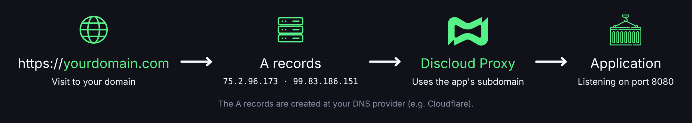
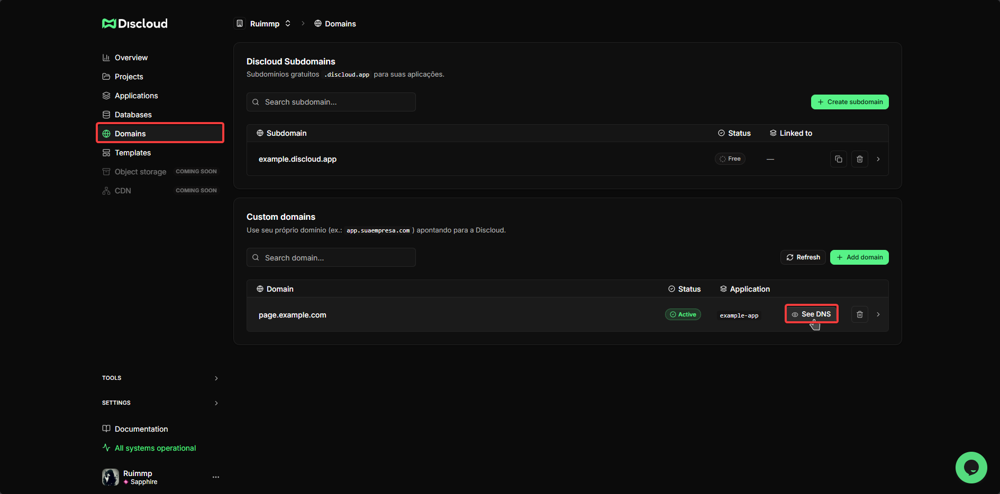
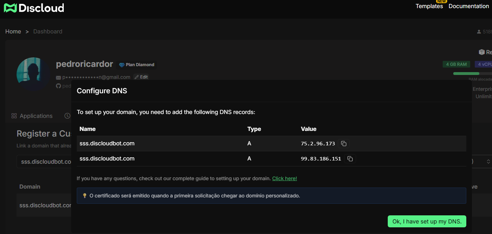
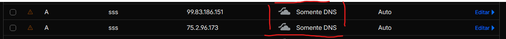
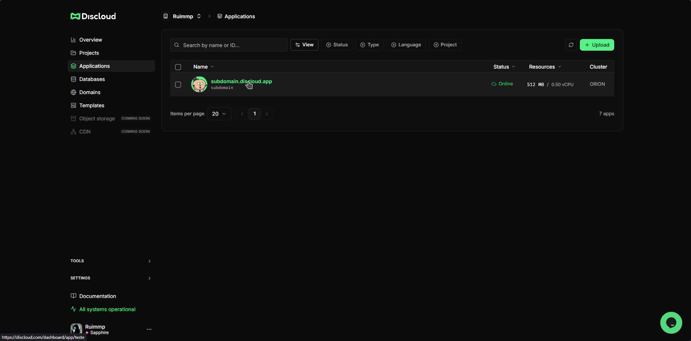
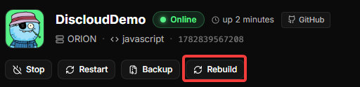

# Domínio Personalizado

## 🧭 Visão Geral

Você pode mapear seu próprio domínio (ex. `seudominio.com`) ou um subdomínio (ex. `dash.seudominio.com`) para uma aplicação hospedada na Discloud. A plataforma serve o tráfego através do [subdomínio Discloud](../faq/general-questions/how-to-create-a-subdomain.md) da sua aplicação usando dois registros A apontando para nossos endereços IPv4.


**Platinum vs Diamond.** Com [Platinum ou superior](https://discloud.com/plans) você já hospeda sites e APIs usando o [subdomínio](../faq/general-questions/how-to-create-a-subdomain.md) que a Discloud fornece (`.discloud.app`, `.discloud.dev` e outros no futuro). O **domínio personalizado** é o recurso à parte: apontar o _seu_ domínio para a aplicação. Isso exige [Diamond ou superior](https://discloud.com/plans).


<figure><figcaption></figcaption></figure>

***

## 📋 Requisitos


[Plano Platinum ou superior](https://discloud.com/plans) – necessário para hospedar websites ou APIs (via subdomínio Discloud).



[Plano Diamond ou superior](https://discloud.com/plans) – necessário para adicionar um **domínio personalizado** à aplicação.



[Aplicação já hospedada](../getting-started/websites-and-apis.md) usando um subdomínio da Discloud (ex. `exemplo.discloud.app`)



Um domínio registrado que você controla (Cloudflare, Hostinger, GoDaddy, Namecheap, etc.)



Capacidade de adicionar / modificar registros A


***

## 🏗️ Adicione Seu Domínio (Painel)



Abra o [Painel da Discloud](https://discloud.com/dashboard) → seção [`Domínios`](https://discloud.com/dashboard/domains).



Clique em **+ Adicionar domínio** e digite seu domínio (ex. `seudominio.com`). Opcionalmente, especifique um subdomínio (ex. `dash`).



Clique em **Ver DNS** para visualizar os registros que precisa configurar.



<figure><figcaption></figcaption></figure> <figure><figcaption></figcaption></figure>

***

## ✅ Configurar DNS

Embora qualquer provedor de DNS funcione, abaixo estão cenários com abas para clareza.



**Registros**

| Tipo | Nome                      | Valor           |
| ---- | ------------------------- | --------------- |
| A    | `@` (ou raiz do provedor) | `75.2.96.173`   |
| A    | `@` (ou raiz do provedor) | `99.83.186.151` |



**Exemplo: `dash.seudominio.com`**

<table><thead><tr><th width="169">Tipo</th><th width="383">Nome</th><th>Valor</th></tr></thead><tbody><tr><td>A</td><td><code>dash</code></td><td><code>75.2.96.173</code></td></tr><tr><td>A</td><td><code>dash</code></td><td><code>99.83.186.151</code></td></tr></tbody></table>

Múltiplos subdomínios (ex. `api`, `app`) repetem este padrão independentemente.




#### **Proxy do Cloudflare**

Se você usar **Cloudflare**, é obrigatório desabilitar o **Proxy** (certifique-se de que está definido como **DNS Only** / **Nuvem Cinza**, não a Laranja). Isso garante a emissão correta do certificado SSL.


<figure><figcaption></figcaption></figure>

***

## 🔄 Reconstruir a Aplicação

Após o DNS propagar, abra a aplicação vinculada e acione a Reconstrução para que a vinculação se torne ativa.

<figure><figcaption></figcaption></figure> <figure><figcaption></figcaption></figure>

***

### 📡 **Propagação DNS**

* Mudanças de DNS normalmente se propagam em alguns minutos.
* No entanto, **valores TTL** e **cache do resolvedor** podem causar alguns atrasos.
* Para verificar as mudanças em todo o mundo, confira [dnschecker.org](https://dnschecker.org/)
* Se alguns POPs ainda exibirem registros antigos, aguarde e verifique novamente mais tarde.

<figure><figcaption></figcaption></figure>

***

## 🛡️ Controlar o tráfego com o Edge

Com o domínio ativo, você pode bloquear caminhos, colocar o site em manutenção, mexer em headers e criar redirecionamentos na borda da Discloud, antes de o pedido chegar na aplicação.


[edge.md](edge.md)

