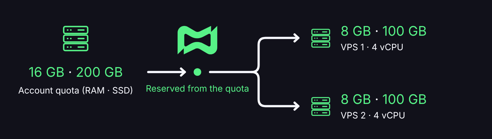

# VPS

## 🖥️ O que é uma VPS na Discloud?

A VPS é um computador na nuvem só seu, com acesso **root** por SSH. Você instala e roda o que precisar nele.

Ela **não** usa a RAM nem o disco do plano de bots e sites. A cota é um [add-on](addons.md) à parte.


São **dois passos separados**. Comprar cota **não** cria a máquina. Criar a máquina **só funciona** se já existir cota livre.


| Ordem  | O que fazer                               | Botão no painel      |
| ------ | ----------------------------------------- | -------------------- |
| **1º** | Comprar (ou aumentar) a cota de RAM + SSD | **Comprar recursos** |
| **2º** | Criar a máquina que consome essa cota     | **Nova VPS**         |

***

## 📍 Onde fica

No [Painel](https://discloud.com/dashboard) → sidebar → **VPS** (`/dashboard/vps`).

No topo da página você vê:

* **Comprar recursos** — abre o fluxo de cota (RAM + SSD).
* **Nova VPS** — abre o formulário da máquina (só use depois da cota paga e livre).

A mesma cota também aparece em **Assinatura / Billing → Add-ons**.

Guia rápido: [Primeiros Passos → VPS](../getting-started/vps.md).

***

## 💾 Passo 1 — Comprar a cota (RAM + SSD)

Sem cota, a lista de VPS fica vazia e o painel pede para **comprar recursos** antes de criar máquina.



**Abrir VPS**

Painel → **VPS**.



**Clicar em Comprar recursos**

No topo da página (ou no empty state, o CTA **Comprar recursos**).



**Escolher GB de RAM e de SSD**

Os dois são comprados **juntos** no mesmo checkout. Você vê o total mensal antes de pagar.

| Recurso  | Mínimo    | Degrau         |
| -------- | --------- | -------------- |
| RAM      | **4 GB**  | de 4 em 4 GB   |
| SSD NVMe | **50 GB** | de 50 em 50 GB |



**Pagar e voltar ao VPS**

Depois do pagamento, a cota entra na conta. O painel mostra quanto está **em uso**, **livre** e **total**. Com cota livre, aí sim dá para criar a máquina.



### O que a cota é (e não é)

A cota é um **pool da conta**, não “uma máquina pronta”. Exemplo: 16 GB de RAM e 200 GB de SSD podem virar uma máquina 16/200 ou duas 8/100, desde que a soma caiba no comprado.

<figure><figcaption></figcaption></figure>

* Dá para **aumentar** a cota depois (de novo em **Comprar recursos**).
* Dá para **reduzir** só até o que as máquinas já usam.
* IPv4, IPv6 e tráfego ilimitado vêm **com a máquina**, não na compra da cota.


**Cancelar a assinatura da cota VPS destrói todas as máquinas da conta.** Apagar uma máquina não cancela a cobrança da cota.


***

## 🚀 Passo 2 — Criar a máquina (depois da cota)

Só continue aqui se a conta já tem **cota livre** suficiente (mínimo típico: 4 GB RAM + 50 GB SSD livres).



**Abrir Nova VPS**

Em **VPS**, clique em **Nova VPS**. Abre o formulário da máquina.



**Preencher a configuração**

| Campo            | O que é                                                                                                 |
| ---------------- | ------------------------------------------------------------------------------------------------------- |
| RAM (GB)         | Quanto da cota **livre** esta máquina reserva. Mínimo **4 GB** (teto por máquina no create: **32 GB**). |
| Disco (GB)       | SSD reservado. Mínimo **50 GB** (teto no create: **500 GB**).                                           |
| vCPU             | Calculado pela RAM — você **não** escolhe.                                                              |
| Região           | Hoje: **América do Norte** (precisa de IP livre).                                                       |
| Sistema          | Ubuntu e outros disponíveis no momento.                                                                 |
| Nome e descrição | Rótulos seus; não mudam preço.                                                                          |

A tela mostra preview de vCPU e o resumo da cota (livre vs o que você está pedindo).



**Confirmar Criar VPS**

Isso **não** abre um plano novo: só reserva GB que você já comprou. Status inicial: **Provisionando** (cerca de \~45 s). Depois: **Online**, com IP.



**Copiar o acesso SSH**

Na visão geral da máquina: IPv4/IPv6, usuário `root`, senha e comando SSH. Guarde a senha — também vai para o e-mail da conta.




Se **Nova VPS** pedir para comprar recursos ou a criação falhar por cota, volte ao **Passo 1** e aumente a cota. Sem GB livres, a máquina não sobe.


### 🧮 vCPU (pela RAM da máquina)

| RAM da máquina   | vCPU     |
| ---------------- | -------- |
| Menos de 4 GB    | Não cria |
| 4 GB até < 8 GB  | 2 vCPU   |
| 8 GB até < 16 GB | 4 vCPU   |
| 16 GB ou mais    | 8 vCPU   |

### 🚦 Status

| Status               | Significado                    |
| -------------------- | ------------------------------ |
| Aguardando pagamento | Cota ainda não paga            |
| Provisionando        | Criando o servidor             |
| Online               | No ar                          |
| Suspensa             | Fora do ar (cobrança/bloqueio) |
| Erro                 | Falha na criação/operação      |

***

## 🔑 Acesso SSH

Na overview da máquina: **IPv4**, **IPv6**, usuário **root**, **senha** e comando **SSH**.


A senha **não fica guardada no faturamento**. Copie na hora. A Discloud também envia IP, usuário e senha por e-mail. Sem a senha salva: recriar a máquina (apaga o disco) ou trocar a senha já dentro do SSH.


***

## 🛠️ Depois de criada

| Ação                         | Dados                                     | Cota / IP                                                          |
| ---------------------------- | ----------------------------------------- | ------------------------------------------------------------------ |
| Ligar / desligar / reiniciar | Disco permanece                           | Permanecem                                                         |
| Aumentar RAM ou disco        | Disco permanece; só sobe até a cota livre | Ocupa mais do pool                                                 |
| Recriar                      | **Apaga o disco** e reinstala o SO        | Cota e IP ficam                                                    |
| Excluir a máquina            | Máquina some                              | Cota **continua na conta** (volta a livre); cobrança da cota segue |
| Cancelar a cota VPS          | **Todas as VPS são destruídas**           | Assinatura RAM/SSD acaba                                           |


Não dá para diminuir RAM/disco de uma máquina existente. Para uma menor: exclua (ou liberte cota) e crie de novo.


***

## 🔀 VPS vs apps

|          | Plano de apps       | VPS                   |
| -------- | ------------------- | --------------------- |
| Produto  | Bot/site gerenciado | Linux com root        |
| Cobrança | Plano Discloud      | Add-on RAM + SSD      |
| Limite   | RAM do plano        | Pool que você comprou |
| Acesso   | Painel              | SSH                   |

VPS **não** aparece na lista de apps. Site Discloud **não** vira VPS.

***

## 🧭 Próximos passos


[addons.md](addons.md)



[where-to-find-things-in-the-dashboard.md](../faq/troubleshooting-solutions/where-to-find-things-in-the-dashboard.md)

