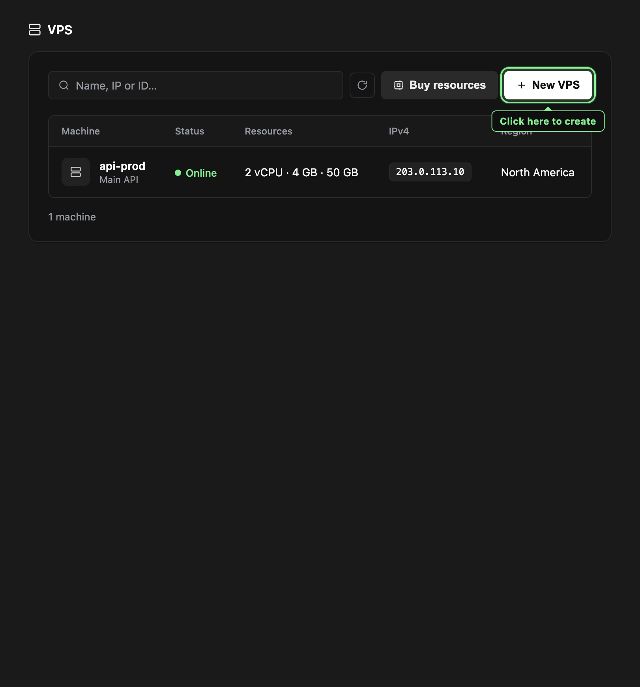
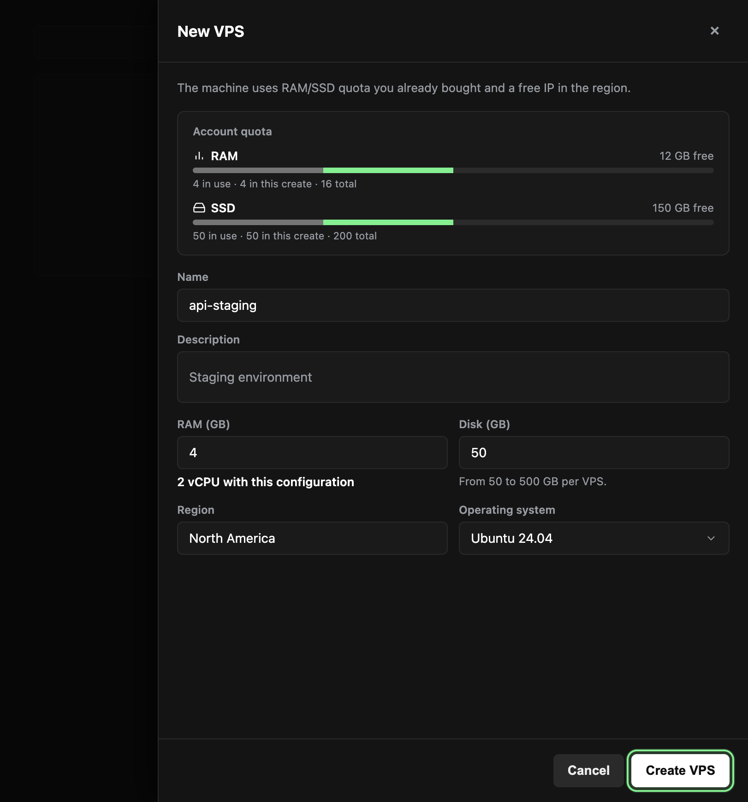

# VPS

## 🖥️ What is a VPS on Discloud?

A VPS is a cloud computer that is yours alone, with **root** access over SSH. You install and run whatever you need on it.

It does **not** use the RAM or disk of the bots and sites plan. Quota is a separate [add-on](addons.md).


There are **two separate steps**. Buying quota does **not** create a machine. Creating a machine **only works** if you already have free quota.


| Order   | What to do                              | Dashboard button  |
| ------- | --------------------------------------- | ----------------- |
| **1st** | Buy (or increase) RAM + SSD quota       | **Buy resources** |
| **2nd** | Create the machine that uses that quota | **New VPS**       |

***

## 📍 Where to find it

In the [Dashboard](https://discloud.com/dashboard) → sidebar → **VPS** (`/dashboard/vps`).

At the top of the page:

* **Buy resources** — opens the quota purchase (RAM + SSD).
* **New VPS** — opens the machine form (use only after quota is paid and free).

The same quota also appears under **Subscription / Billing → Add-ons**.

Short intro: [Getting Started → VPS](../getting-started/vps.md).

***

## 💾 Step 1 — Buy quota (RAM + SSD)

Without quota, the VPS list is empty and the dashboard asks you to **buy resources** before creating a machine.



**Open VPS**

Dashboard → **VPS**.



**Click Buy resources**

At the top of the page (or the empty-state **Buy resources** CTA).



**Choose GB of RAM and SSD**

Both are purchased **together** in the same checkout. You see the monthly total before paying.

| Resource | Minimum   | Step            |
| -------- | --------- | --------------- |
| RAM      | **4 GB**  | 4 GB at a time  |
| SSD NVMe | **50 GB** | 50 GB at a time |



**Pay and return to VPS**

After payment, quota is on the account. The dashboard shows **in use**, **free**, and **total**. With free quota, you can create a machine.



### What quota is (and is not)

Quota is an **account pool**, not “a ready-made machine”. Example: 16 GB RAM and 200 GB SSD can become one 16/200 machine or two 8/100 machines, as long as the total fits.

<figure><figcaption></figcaption></figure>

* You can **increase** quota later (again via **Buy resources**).
* You can **decrease** it only down to what machines already use.
* IPv4, IPv6 and unlimited traffic come **with the machine**, not with the quota purchase.


**Canceling the VPS quota subscription destroys every machine on the account.** Deleting a machine does not cancel quota billing.


***

## 🚀 Step 2 — Create the machine (after quota)

Only continue here if the account already has enough **free quota** (typical minimum: 4 GB RAM + 50 GB SSD free).



**Click New VPS**

On **VPS**, top right, the white **New VPS** button (next to **Buy resources**). That is the button that opens machine creation — not the quota purchase.

<figure><figcaption></figcaption></figure>



**Fill in the New VPS sheet**

The side sheet **New VPS** opens. At the top you see **Account quota** (free GB and what this create will reserve). Then fill in:

| Field                | What it is                                                                                           |
| -------------------- | ---------------------------------------------------------------------------------------------------- |
| Name and description | Your labels; they don’t change price.                                                                |
| RAM (GB)             | How much **free** quota this machine reserves. Minimum **4 GB** (create cap per machine: **32 GB**). |
| Disk (GB)            | Reserved SSD. Minimum **50 GB** (create cap: **500 GB**).                                            |
| vCPU                 | Calculated from RAM — you **don’t** choose it (the screen shows a preview).                          |
| Region               | Currently: **North America** (needs a free IP).                                                      |
| Operating system     | Ubuntu and others available at the moment.                                                           |

<figure><figcaption></figcaption></figure>



**Confirm Create VPS**

At the bottom of the sheet, click **Create VPS**. This does **not** open a new plan: it only reserves GB you already bought. Initial status: **Provisioning** (\~45 s). Then: **Online**, with IP.



**Copy SSH access**

On the machine overview: IPv4/IPv6, user `root`, password and SSH command. Save the password — it’s also emailed to the account.




If **New VPS** asks you to buy resources or creation fails for quota, go back to **Step 1** and increase quota. Without free GB, the machine won’t start.


### 🧮 vCPU (from machine RAM)

| Machine RAM     | vCPU        |
| --------------- | ----------- |
| Less than 4 GB  | Not created |
| 4 GB to < 8 GB  | 2 vCPU      |
| 8 GB to < 16 GB | 4 vCPU      |
| 16 GB or more   | 8 vCPU      |

### 🚦 Status

| Status           | Meaning                 |
| ---------------- | ----------------------- |
| Awaiting payment | Quota not paid yet      |
| Provisioning     | Creating the server     |
| Online           | Up                      |
| Suspended        | Offline (billing/block) |
| Error            | Create/operation failed |

***

## 🔑 SSH access

On the machine overview: **IPv4**, **IPv6**, user **root**, **password**, and **SSH** command.


The password is **not stored in billing**. Copy it immediately. Discloud also emails IP, user and password. If you didn’t save it: recreate the machine (wipes the disk) or change the password yourself over SSH.


***

## 🛠️ After creation

| Action                 | Data                                     | Quota / IP                                                             |
| ---------------------- | ---------------------------------------- | ---------------------------------------------------------------------- |
| Start / stop / restart | Disk kept                                | Kept                                                                   |
| Increase RAM or disk   | Disk kept; only up to free quota         | Uses more of the pool                                                  |
| Recreate               | **Wipes the disk** and reinstalls the OS | Quota and IP kept                                                      |
| Delete the machine     | Machine gone                             | Quota **stays on the account** (becomes free); quota billing continues |
| Cancel VPS quota       | **Every VPS is destroyed**               | RAM/SSD subscription ends                                              |


You can’t shrink RAM/disk on an existing machine. For a smaller one: delete (or free quota) and create again.


***

## 🔀 VPS vs apps

|         | App plan         | VPS              |
| ------- | ---------------- | ---------------- |
| Product | Managed bot/site | Linux with root  |
| Billing | Discloud plan    | RAM + SSD add-on |
| Limit   | Plan RAM         | Pool you bought  |
| Access  | Dashboard        | SSH              |

A VPS does **not** appear in the apps list. A Discloud site does **not** become a VPS.

***

## 🧭 Next steps


[addons.md](addons.md)



[where-to-find-things-in-the-dashboard.md](../faq/troubleshooting-solutions/where-to-find-things-in-the-dashboard.md)

